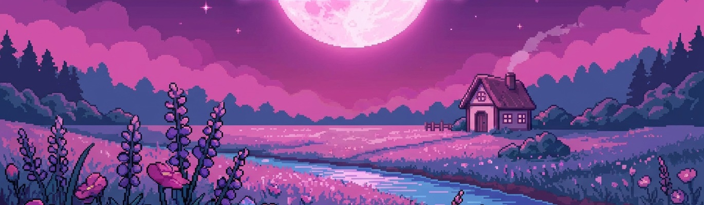
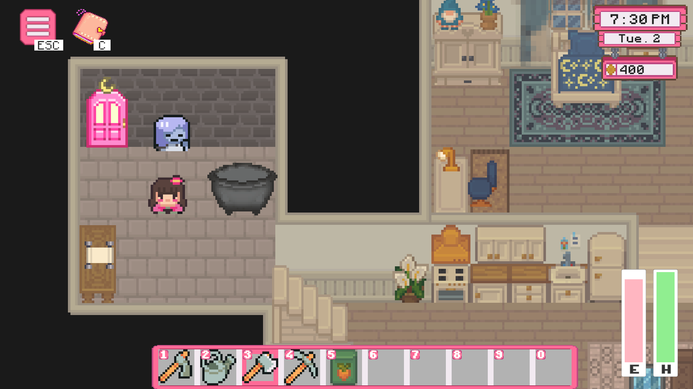

# ✦ ADRIANA TARRATS ✦

### Developer · Creative Thinker · Product Enthusiast

*Designing, building and bringing ideas to life.*

---

## ✿ About Me

I'm a **Computer Science & Software Engineering graduate** with a creative mindset and a passion for the intersection of design, technology and user experience.

I enjoy transforming ideas into useful, intuitive and visually engaging products. From designing interfaces and experimenting with prototypes to bringing ideas to life through code, I love exploring the entire creative process.

I'm currently looking for an opportunity to join a team where I can keep learning, contribute ideas and help build meaningful digital experiences.

---

## 🌙 Featured Project

### Moonlight Meadow
**An educational 2D game · C# & Unity**

*A cozy educational game that introduces computational thinking through interactive gameplay and potion-making mechanics.*

**My contribution**
- Independent design and development, from concept to implementation.
- Design of interfaces, interactions and gameplay systems.
- User testing with 10 participants and improvements based on their feedback.

**Bachelor thesis grade: 10/10**

---

## ✨ My Toolkit

| | Skills & Technologies |
|:--|:--|
| 🎨 **Design & Prototyping** | Figma · Lovable · UI/UX · Visual Design |
| 💻 **Frontend Development** | HTML · CSS · JavaScript · TypeScript · Vue.js |
| ⚙️ **Programming** | C# · Python · Java · C · C++ · SQL · PHP |
| 🛠️ **Tools & Technologies** | Unity · Git · GitHub · Linux · Docker · Bash |
| ✨ **AI-assisted Development** | Claude · GitHub Copilot |

---

## 💌 Let's Connect!

I'm always happy to connect with people who enjoy creating, experimenting and building meaningful things.

[LinkedIn](https://www.linkedin.com/in/adriana-tarrats-mejia/) · [GitHub](https://github.com/AdrianaTarrats)

*Thanks for stopping by! ✿*

